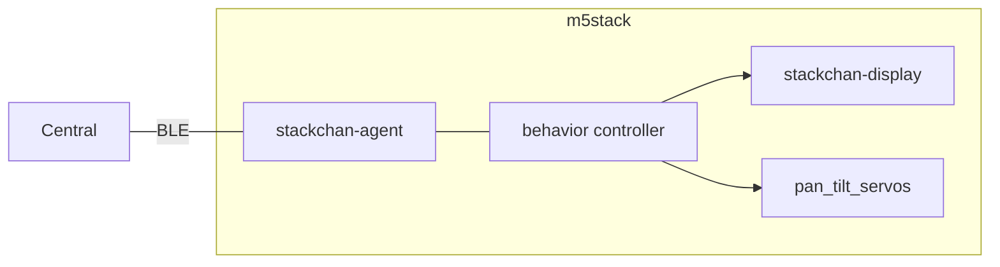
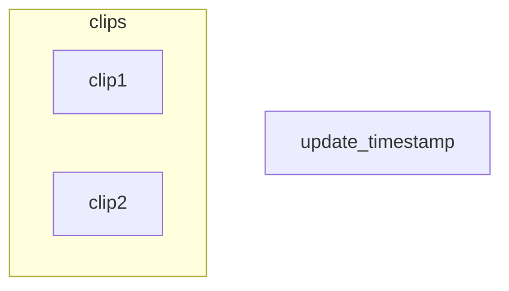

# Stackchan Agent

[](https://github.com/botamochi6277/stackchan-agent/actions/workflows/pioarduino-ci.yml)

*stackchan-agent* is the root controller of the Super kawaii StackChan.
It decides how StackChan behaves, like an NPC, and drives the other modules:

- [stackchan-display](https://github.com/botamochi6277/stackchan-display) is a library to control facial expression.
- *pan tilt servos* (`include/Animation.hpp`) is a sub library of this repository to control servo motions and animations.
- [StackChan-BSP](https://github.com/botamochi6277/StackChan-BSP) is the board support package of the StackChan body (servos, head touch sensor, LEDs).



## Features

- **Behavior controller**: a hierarchical state machine (`Idle`, `Attentive`, `Interacting`, `Talking`, `Sleeping`, `LowBattery`) with an idle picker that makes StackChan look around, nod and smile on its own.
  Touching the head makes it smile and nod, and it falls asleep after 5 minutes without events. See [behavior.md](behavior.md).
- **Face and expression** with [stackchan-display](https://github.com/botamochi6277/stackchan-display). Buttons A/B change the face and the expression, and flicking the screen changes them too (manual debug control).
- **Head motion** with animation clips (look front / up / down / left / right, nod, shake). Button C plays the clips in order. See [animation.md](animation.md).
- **BLE service** to control the face and servos from a central device. The BLE code is currently commented out in `src/main.cpp`.

Sensor inputs other than the head touch sensor (camera, microphone, battery, BLE / LLM) are not connected to the behavior controller yet.
See the plan in [behavior.md](behavior.md) and the overall design in [policy.md](policy.md).

## Build

Install [PlatformIO](https://platformio.org/) (or the [pioarduino](https://marketplace.visualstudio.com/items?itemName=pioarduino.pioarduino-ide) VSCode extension), then run in this directory:

```bash
pio run -e m5stack-cores3-stackchan-body              # build (default env)
pio run -e m5stack-cores3-stackchan-body -t upload    # upload
pio device monitor                                    # 115200 baud
```

| env | board |
| --- | --- |
| `m5stack-cores3-stackchan-body` | CoreS3 on the StackChan body (default) |
| `m5stack-cores3` | M5Stack CoreS3 |
| `m5stack-core2` | M5Stack Core2 |
| `m5stack-core1` | M5Stack Core (Basic / Gray) |

Notes on dependencies:

- `M5Unified` is pinned to `0.2.26`, and `StackChan-BSP` is taken from the fork `botamochi6277/StackChan-BSP`, because `StackChan-BSP` 1.1.0 from the registry does not compile with recent `M5Unified`.
- `stackchan-display` is pinned to the tag `0.4.0`.

## Test

The behavior controller (`include/Behavior.hpp`) does not depend on Arduino or M5Unified, so it is tested on the PC with a C++17 compiler:

```bash
g++ -std=c++17 -Wall -Iinclude test/test_behavior.cpp -o test_behavior
./test_behavior
```

## Service Detail

The BLE service is currently disabled in `src/main.cpp`.

```json
{
  "name": "StackchanService",
  "uuid": "671e0000-8cef-46b7-8af3-2eddeb12803e",
  "characteristics": [
    {
      "name": "timer_chr",
      "uuid": "671e0001-8cef-46b7-8af3-2eddeb12803e",
      "data_type": "UnsignedLong",
      "properties": ["Read", "Notify"]
    },
    {
      "name": "facial_expression_chr",
      "uuid": "671e1000-8cef-46b7-8af3-2eddeb12803e",
      "data_type": "UnsignedChar",
      "properties": ["Read", "Write"]
    },
    {
      "name": "is_servo_activated_chr",
      "uuid": "671e2000-8cef-46b7-8af3-2eddeb12803e",
      "data_type": "Boolean",
      "properties": ["Read", "Write"]
    },
    {
      "name": "servo_pan_angle_chr",
      "uuid": "671e2001-8cef-46b7-8af3-2eddeb12803e",
      "data_type": "UnsignedChar",
      "properties": ["Read", "Write"]
    },
    {
      "name": "servo_tilt_angle_chr",
      "uuid": "671e2002-8cef-46b7-8af3-2eddeb12803e",
      "data_type": "UnsignedChar",
      "properties": ["Read", "Write"]
    }
  ]
}
```

## Animation


