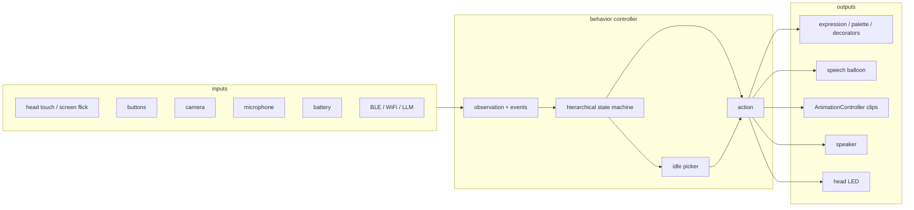
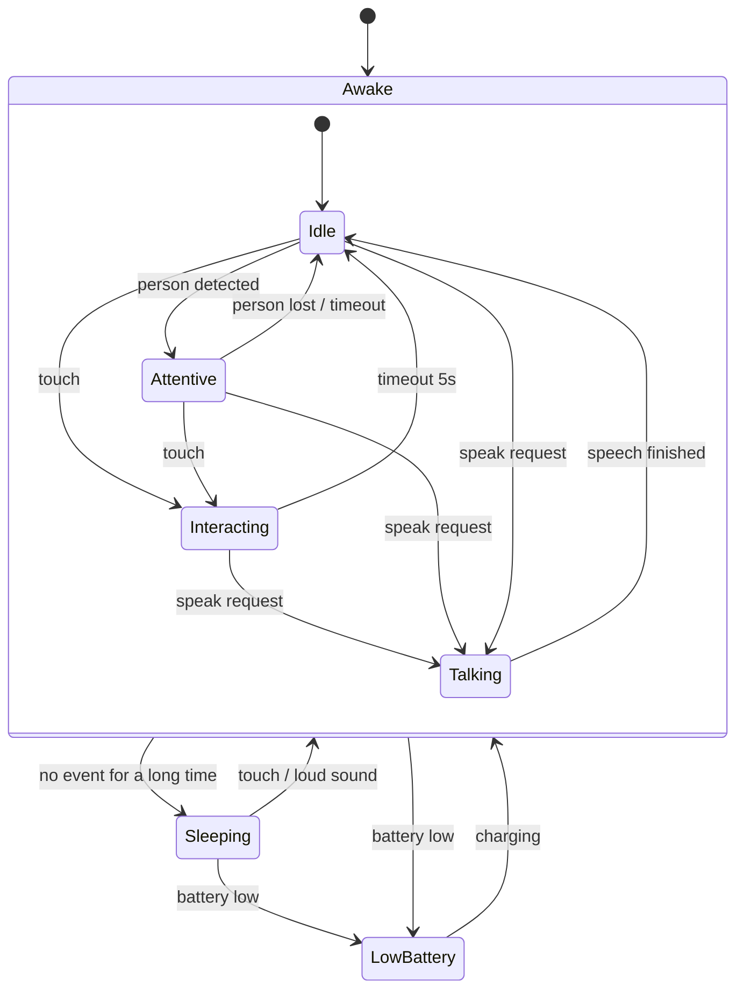

# StackChan behavior controller

Draft design. Nothing in this document is implemented yet.

## Purpose

StackChan should behave like a small NPC: it reacts to touch, sound and people, and it does not stand still when nobody interacts with it.
The behavior controller decides *what StackChan does next*. It does not draw faces or move servos by itself.

Today this logic is scattered over the `M5_update` task in [src/main.cpp](src/main.cpp) as timestamps and counters (`last_touch_detected_time`, `last_facial_expression_changed_time`, `m5_count % (100 * 60)`).
The controller replaces it with explicit states, events and timeouts.

## Decision

Use a **hierarchical state machine (HSM)** as the main controller, with a **weighted random picker** for idle behaviors inside states.

| Method | Verdict | Reason |
|---|---|---|
| Flat state machine | Not enough | Transitions multiply as modes grow |
| **Hierarchical state machine** | **Adopt** | Few modes, event driven, interrupts handled by parent states, tiny RAM/CPU use, easy to log |
| Behavior tree | Later, if needed | Good for many reusable conditions, but more machinery than a small repertoire needs |
| Weighted random / utility | Adopt inside states | Gives idle variety without a full planner |
| Learned policy | Later | Needs reference motions; fits behind the same interface (see below) |

## Where it sits

The controller is the `policy` block of [policy.md](policy.md).



Always-on behaviors stay in their libraries and are **not** part of the controller: blink and breath live in `stackchan-display`, servo interpolation lives in `AnimationController`.

## States



| State | Meaning | Face | Motion | Idle picker |
|---|---|---|---|---|
| `Idle` | Awake and alone | neutral | occasional look-around, nod | yes |
| `Attentive` | Someone is in front | neutral, looks toward the person | look front | few, small |
| `Interacting` | Being touched | smile + blush + heart | nod | no |
| `Talking` | Speaking / showing a message | per message | small nods | no |
| `Sleeping` | Nobody for a long time | sleepy, eyes closed | look down | no |
| `LowBattery` | Needs charging | sad, pale mark | none | no |

Rules of the hierarchy:

- A transition defined on a parent state (`Awake`) applies to all its children, so `Awake -> LowBattery` is written once.
- `LowBattery` is above everything else. `Sleeping` is below touch.
- Each state has `onEnter`, `onUpdate(dt)` and `onExit`. Timeouts are timers owned by the state, replacing the global timestamps.

## Events

Events are produced from sensors and communication. States never read sensors directly.

| Event | Source | Today |
|---|---|---|
| `Touched` | head touch sensor `wasClicked()` | `main.cpp` sets smile for 5 s |
| `Flicked(dir)` | screen flick | changes face / expression (manual debug control) |
| `ButtonPressed(id)` | buttons A/B/C | manual debug control |
| `PersonDetected` / `PersonLost` | camera | not available |
| `LoudSound` | microphone | not available |
| `BatteryLow` / `Charging` | battery sensor | not available |
| `SpeakRequest(text)` | BLE / WiFi / LLM | not available |
| `SpeechFinished` | speaker | not available |
| `Timeout` | state timer | `millis() - last_... > 5000` |

Manual debug control (buttons, flicks) can stay outside the controller, as an override that bypasses it.

## Interface

The controller is a pure function of observations and time, so it can be unit tested on the PC (`native` env) without hardware, and later swapped for a behavior tree or a learned policy.

```cpp
struct Observation {
  uint32_t now_ms;
  bool head_touched;      // edge: true for one tick
  bool person_visible;
  bool loud_sound;
  float battery_level;    // 0..1
  bool charging;
  // pending messages from BLE/WiFi/LLM are delivered as events
};

struct Action {
  // display
  stackchan::display::Expression expression;   // emotional expression
  uint8_t blush;                               // 0..255, kBlush
  const char* speech;                          // nullptr = keep current
  // motion
  int8_t animation;                            // AnimationName, -1 = none
  // later: led color, voice
};

class BehaviorController {
 public:
  virtual ~BehaviorController() = default;
  virtual void pushEvent(const Event& event) = 0;
  virtual Action update(const Observation& obs) = 0;   // called at ~30 Hz
};
```

`HsmBehavior : BehaviorController` is the first implementation.
`main.cpp` applies the returned `Action` to `display` and `anim_controller`.
Applying only *changes* (not every tick) avoids restarting animations.

## Idle picker

Inside `Idle` (and a reduced set in `Attentive`), actions are chosen by weights and random delays:

| Candidate | Weight | Cooldown |
|---|---|---|
| look left / right / up | 3 | 10 s |
| nod | 1 | 30 s |
| small expression change (smile for 2 s) | 1 | 30 s |
| do nothing | 5 | - |

The next pick happens after `random(3 s, 10 s)`. Weights and cooldowns are data, so tuning does not need code changes.

## Scheduling

- Add one `Tasks` entry `Behavior_Update` at about 30 fps, next to `Facial_Update` and `Animation_Update`. All work is non-blocking.
- Sensors are read in the existing `M5_update` task (100 fps) and turned into events and an `Observation`.
- LLM or WiFi requests are asynchronous: they only push `SpeakRequest` events, so a slow network never blocks the face or motion.

## Debugging

- Log every transition: `state A -> B (event)` through `M5_LOGI`.
- Optionally show the current state name in the speech balloon in a debug build.
- Unit tests on `native`: feed a scripted event list and check the state sequence and the actions.

## Implementation plan

1. Add `include/Behavior.hpp` with `Event`, `Observation`, `Action` and the `BehaviorController` interface.
2. Implement `HsmBehavior` with `Idle`, `Interacting` and `Sleeping`. This reproduces today's behavior (touch -> smile 5 s -> neutral) and adds sleep.
3. Move the touch / timer code out of `M5_update` in `main.cpp`, apply `Action` to display and animations.
4. Add the idle picker and tune weights on a real device.
5. Add `Attentive` and `Talking` when camera and BLE/LLM inputs exist.
6. Add `LowBattery` with the battery sensor.
7. Add native tests for the state sequences.

## Open questions

- What should wake StackChan from `Sleeping`: touch only, or also sound?
- Should `Interacting` depend on the touch position (top, front, back of the head)? The head sensor has three zones.
- Should manual button / flick control stay in release builds, or only in debug builds?
- Which messages from the LLM may interrupt `Interacting`?
- Behavior tree: revisit when the number of states or conditions grows past about ten, or when behaviors need to be shared between states.
