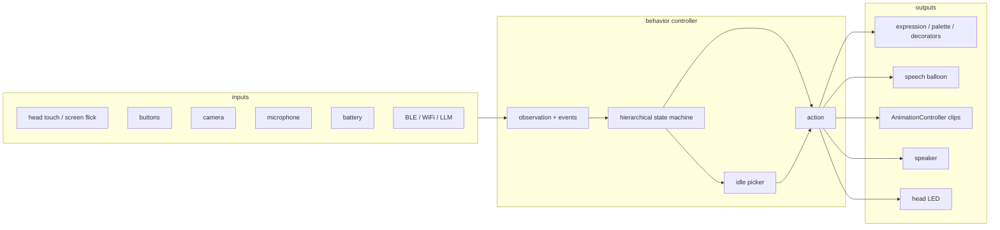
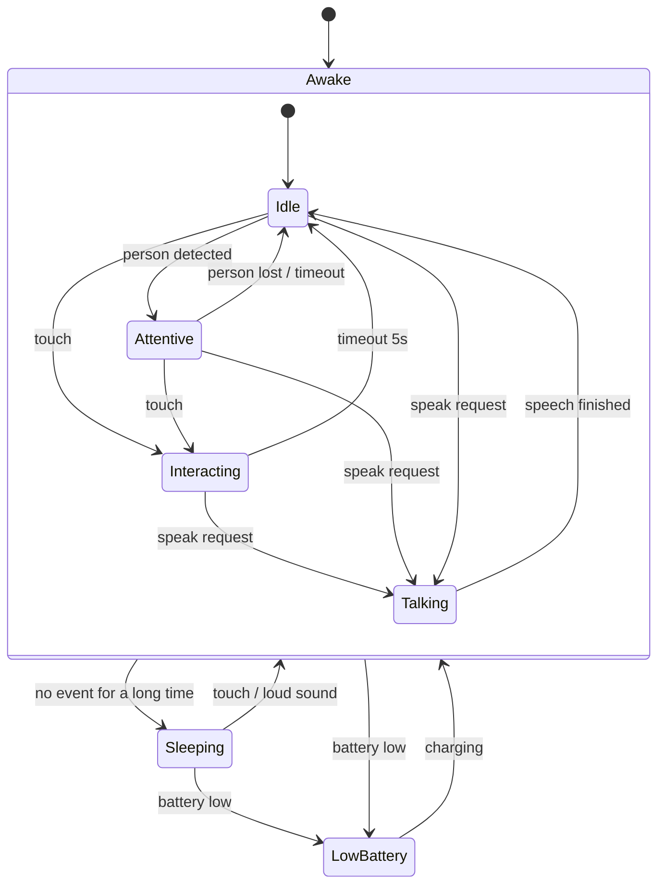

# StackChan behavior controller

Status: the controller core is implemented in [include/Behavior.hpp](include/Behavior.hpp) and wired into [src/main.cpp](src/main.cpp).
Host tests: [test/test_behavior.cpp](test/test_behavior.cpp).
Touch events work today. Camera, microphone, battery and BLE/LLM events are defined and tested, but no sensor produces them yet.

## Purpose

StackChan should behave like a small NPC: it reacts to touch, sound and people, and it does not stand still when nobody interacts with it.
The behavior controller decides *what StackChan does next*. It does not draw faces or move servos by itself.

Today this logic is scattered over the `M5_update` task in [src/main.cpp](src/main.cpp) as timestamps and counters (`last_touch_detected_time`, `last_facial_expression_changed_time`, `m5_count % (100 * 60)`).
The controller replaces it with explicit states, events and timeouts.

## Decision

Use a **hierarchical state machine (HSM)** as the main controller, with a **weighted random picker** for idle behaviors inside states.

| Method | Verdict | Reason |
|---|---|---|
| Flat state machine | Not enough | Transitions multiply as modes grow |
| **Hierarchical state machine** | **Adopt** | Few modes, event driven, interrupts handled by parent states, tiny RAM/CPU use, easy to log |
| Behavior tree | Later, if needed | Good for many reusable conditions, but more machinery than a small repertoire needs |
| Weighted random / utility | Adopt inside states | Gives idle variety without a full planner |
| Learned policy | Later | Needs reference motions; fits behind the same interface (see below) |

## Where it sits

The controller is the `policy` block of [policy.md](policy.md).



Always-on behaviors stay in their libraries and are **not** part of the controller: blink and breath live in `stackchan-display`, servo interpolation lives in `AnimationController`.

## States



| State | Meaning | Face | Motion | Idle picker |
|---|---|---|---|---|
| `Idle` | Awake and alone | neutral | occasional look-around, nod | yes |
| `Attentive` | Someone is in front | neutral, looks toward the person | look front | few, small |
| `Interacting` | Being touched | smile + blush + heart | nod | no |
| `Talking` | Speaking / showing a message | per message | small nods | no |
| `Sleeping` | Nobody for a long time | sleepy, eyes closed | look down | no |
| `LowBattery` | Needs charging | sad, pale mark | none | no |

Rules of the hierarchy:

- A transition defined on a parent state (`Awake`) applies to all its children, so `Awake -> LowBattery` is written once.
- `LowBattery` is above everything else. `Sleeping` is below touch.
- Each state has `onEnter`, `onUpdate(dt)` and `onExit`. Timeouts are timers owned by the state, replacing the global timestamps.

## Events

Events are produced from sensors and communication. States never read sensors directly.

| Event | Source | Today |
|---|---|---|
| `Touched` | head touch sensor `wasClicked()` | `main.cpp` sets smile for 5 s |
| `Flicked(dir)` | screen flick | changes face / expression (manual debug control) |
| `ButtonPressed(id)` | buttons A/B/C | manual debug control |
| `PersonDetected` / `PersonLost` | camera | not available |
| `LoudSound` | microphone | not available |
| `BatteryLow` / `Charging` | battery sensor | not available |
| `SpeakRequest(text)` | BLE / WiFi / LLM | not available |
| `SpeechFinished` | speaker | not available |
| `Timeout` | state timer | `millis() - last_... > 5000` |

Manual debug control (buttons, flicks) can stay outside the controller, as an override that bypasses it.

## Interface

The controller is a pure function of events and time, so it is tested on the PC without hardware (`Behavior.hpp` does not include Arduino or M5Unified), and it can later be swapped for a behavior tree or a learned policy.

```cpp
namespace stackchan::behavior {

enum class EventType { kTouched, kPersonDetected, kPersonLost, kLoudSound,
                       kBatteryLow, kCharging, kSpeakRequest, kSpeechFinished };
struct Event { EventType type; char text[48]; };   // text is used by kSpeakRequest

struct Observation { uint32_t now_ms; };

struct Action {              // apply only what is set
  bool set_mood;   Mood mood;            // kNeutral, kSmile, kAngry, kSad, kSleepy, kDoubt
  bool set_speech; const char* speech;   // "" hides the balloon
  Motion motion;                         // same values as AnimationName, kNone = no motion
};

class HsmBehavior {
 public:
  void pushEvent(const Event&);          // queued, handled in the next update()
  Action update(const Observation&);     // call at about 30 Hz
  State state() const;
  // tunable timings: interacting_ms, attentive_timeout_ms, sleep_after_ms, pick_min_ms, pick_max_ms
  // on_transition: callback for logging
};
}
```

`main.cpp` pushes `kTouched` from the head touch sensor, runs `Behavior_Update` at 30 fps, and maps the returned `Action` to the display (`setEmotionalExpression`, speech balloon) and `AnimationController`.
Because only changes are returned, animations are not restarted every tick.
`Mood` and `Motion` are the controller's own enums, so it does not depend on the display library.

Behavior notes:

- Touching in `Talking` is ignored, so speech is not interrupted. Touching again in `Interacting` restarts the timer and the nod.
- A touch while `Sleeping` wakes StackChan directly into `Interacting`. A loud sound wakes it into `Idle`.
- `SpeakRequest` shows the text for `2 s + 80 ms per character` (max 15 s) unless `SpeechFinished` arrives first.
- Events are ignored while in `LowBattery`, except `Charging`.
- Buttons and flicks in `main.cpp` stay outside the controller as manual debug control. The manually set expression stays until the controller next sets a mood.

## Idle picker

Inside `Idle` (and a reduced set in `Attentive`), actions are chosen by weights and random delays:

| Candidate | Weight | Cooldown |
|---|---|---|
| look left / right / up | 3 | 10 s |
| nod | 1 | 30 s |
| small expression change (smile for 2 s) | 1 | 30 s |
| do nothing | 5 | - |

The next pick happens after `random(3 s, 10 s)`. Weights and cooldowns are data, so tuning does not need code changes.

## Scheduling

- Add one `Tasks` entry `Behavior_Update` at about 30 fps, next to `Facial_Update` and `Animation_Update`. All work is non-blocking.
- Sensors are read in the existing `M5_update` task (100 fps) and turned into events and an `Observation`.
- LLM or WiFi requests are asynchronous: they only push `SpeakRequest` events, so a slow network never blocks the face or motion.

## Debugging

- Log every transition: `state A -> B (event)` through `M5_LOGI`.
- Optionally show the current state name in the speech balloon in a debug build.
- Unit tests on `native`: feed a scripted event list and check the state sequence and the actions.

## Implementation plan

1. [x] `include/Behavior.hpp`: events, actions, `HsmBehavior` with all states (`Idle`, `Attentive`, `Interacting`, `Talking`, `Sleeping`, `LowBattery`).
2. [x] Touch -> smile -> neutral after 5 s, plus sleep after 5 minutes, replaces the timer code in `main.cpp`.
3. [x] Idle picker, replacing the random motion every minute.
4. [x] Host tests for the state sequences and the picker.
5. [ ] Tune weights, cooldowns and timings on a real device.
6. [ ] Produce `PersonDetected` / `PersonLost` (camera) and `LoudSound` (microphone).
7. [ ] Produce `BatteryLow` / `Charging` from the battery sensor.
8. [ ] Produce `SpeakRequest` from BLE / WiFi / LLM.
9. [ ] Cheek blush with a smile (needs a newer `stackchan-display` than 0.4.0, which has no `kBlush`).

## Open questions

- What should wake StackChan from `Sleeping`: touch only, or also sound?
- Should `Interacting` depend on the touch position (top, front, back of the head)? The head sensor has three zones.
- Should manual button / flick control stay in release builds, or only in debug builds?
- Which messages from the LLM may interrupt `Interacting`?
- Behavior tree: revisit when the number of states or conditions grows past about ten, or when behaviors need to be shared between states.
